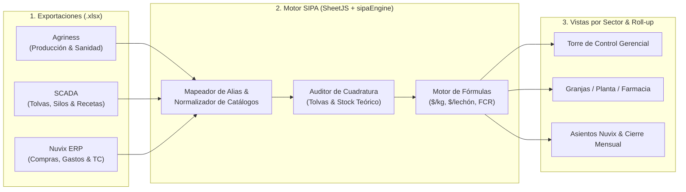

# 🐖 SIPA PROJECT — Sistema Integral de Producción Agro-porcina

> **Hackaton Agro 2026 · Desafío 07: Uniporc Tandil**  
> Plataforma unificadora de gestión productiva (**Agriness / S4Farm**), planta de alimentos balanceados (**SCADA**) y administración contable (**Nuvix ERP**).

---

## 📋 Índice de Documentación

1. [Problema de Negocio y Propuesta de Valor](#-1-problema-de-negocio-y-propuesta-de-valor)
2. [Arquitectura Funcional y Flujo End-to-End](#-2-arquitectura-funcional-y-flujo-end-to-end)
3. [Relación entre Tablas y Mapeo Columna por Columna](#-3-relación-entre-tablas-y-mapeo-columna-por-columna)
4. [Catálogo Completo de las 9 Fórmulas de Negocio](#-4-catálogo-completo-de-las-9-fórmulas-de-negocio)
5. [Separación de Vistas por Sectores Operativos](#-5-separación-de-vistas-por-sectores-operativos)
6. [Sistema de Diseño UX/UI y Accesibilidad (WCAG 2.2 AA)](#-6-sistema-de-diseño-uxui-y-accesibilidad-wcag-22-aa)
7. [Stack Tecnológico y Preparación para Iteración 2 (Backend & BD)](#-7-stack-tecnológico-y-preparación-para-iteración-2-backend--bd)
8. [Instalación y Ejecución Local](#-8-instalación-y-ejecución-local)

*(Documentación técnica extendida disponible en la carpeta [`/docs`](./docs) y dentro de la pestaña **7. Documentación & Fórmulas** de la aplicación).*

---

## 🎯 1. Problema de Negocio y Propuesta de Valor

**Uniporc Tandil** opera un circuito industrial-biológico intensivo en múltiples establecimientos (**Tandil**, **San Lorenzo**, **Porcap**) divididos en tres etapas productivas (**Sitio 1: Maternidad**, **Sitio 2: Recría**, **Sitio 3: Engorde**). Actualmente utiliza tres sistemas especializados que no se comunican entre sí:

| Sistema | Función Actual | Limitación Principal |
|---|---|---|
| **Agriness / S4Farm** | Gestión biológica en granja (partos, destetes, mortandad, ganancia de peso en kg, aplicaciones sanitarias). | No conoce precios de compra, fletes, sueldos ni tipo de cambio. |
| **SCADA** | Automatización industrial en Planta de Alimentos Balanceados (pesaje de tolvas, fórmulas, silos de maíz y soja). | No sabe cuánto costó la factura de cada grano ni qué lote de animales lo consumió. |
| **Nuvix ERP** | Administración, compras, facturación, fletes en USD/ARS y contabilidad por centros de costo. | No maneja variables zootécnicas (lechones destetados, conversión alimenticia ni mermas de tolva). |

### ¿Qué resuelve SIPA?
1. **Elimina el "puente manual" de planillas Excel:** Lee directamente las exportaciones `.xlsx` de los 3 softwares mediante un motor de mapeo de alias.
2. **Calcula al instante los KPIs críticos que ningún sistema puede calcular por separado:**
   * **Costo por Kg Producido ($\text{\$/kg}$)**
   * **Costo por Lechón Destetado ($\text{\$/lechón}$)** *(pedido explícito de la referente de Uniporc)*
   * **Conversión Alimenticia Aparente ($\text{FCR}$)**
3. **Habilita controles continuos durante el mes sin perder el Cierre Mensual:** Detecta discrepancias de stock en Farmacia y desvíos de balanza en SCADA a mitad de mes, antes de congelar el cierre contable.

---

## 🔄 2. Arquitectura Funcional y Flujo End-to-End



---

## 🔗 3. Relación entre Tablas y Mapeo Columna por Columna

Los archivos originales no comparten un ID único de transacción. SIPA construye la integridad relacional a través de **4 claves canónicas**:

| Clave Canónica SIPA | Columna en Agriness | Columna en SCADA | Columna en Nuvix ERP | Equivalencias de Catálogo |
|---|---|---|---|---|
| `establishmentId` | `Establecimiento` (`03`, `04`), Hojas `Granja A/B` (`05`) | `Planta ficticia` (`07`, `08`) | `Centro ficticio` (`01`), `Centro` (`04`) | `Granja A` / `Planta A` $\rightarrow$ **Tandil**<br/>`Granja B` / `Planta B` $\rightarrow$ **San Lorenzo**<br/>`Granja C` / `Planta C` $\rightarrow$ **Porcap** |
| `stage` | `Fase` (`Sitio 2`, `Sitio 3` en `03`), `Maternidad` (`09`) | Tipo de dieta (`Iniciador`, `Terminador`) | Sub-centro contable | `Sitio 1` $\rightarrow$ **Maternidad**<br/>`Sitio 2` $\rightarrow$ **Recría**<br/>`Sitio 3` $\rightarrow$ **Engorde** |
| `productCode` | `Codigo ficticio` (`P-001`, `P-002`, `P-003` en `05`) | `Codigo ficticio` (`MP-01`, `MP-02` en `06`) | `Producto ficticio` / `Producto` (`04`) | Vincula códigos técnicos con descripciones comerciales |
| `period` | Período de producción | `Fecha` de batch (`08`) / Ajuste (`06`) | `Mes` (`Julio`, `Agosto`, `Septiembre` en `02`) | Agrupación mensual con estado `ABIERTO` o `CERRADO` |

---

## 🧮 4. Catálogo Completo de las 9 Fórmulas de Negocio

Todas las fórmulas se encuentran implementadas y documentadas en [`src/services/sipaEngine.ts`](./src/services/sipaEngine.ts):

1. **Costo Total por Centro / Etapa ($\text{\$}$):**
   $$\text{Total \$} = \text{Alimento \$} + \text{Sanidad \$} + \text{Mano de Obra \$} + \text{Otros \$}$$
2. **Costo por Kg Producido ($\text{\$/kg}$):**
   $$\text{Costo por kg} = \frac{\text{Total Costo \$ (Nuvix + SCADA)}}{\text{Kg Producidos (Agriness)}}$$
   *Verificación Septiembre (Guía 01/02):* Tandil $\$4.410.000 \div 24.000\text{ kg} = \$183,75/\text{kg}$ | San Lorenzo $\$3.800.000 \div 21.000\text{ kg} = \$180,95/\text{kg}$ | Consolidado $\$8.210.000 \div 45.000\text{ kg} = \$182,44/\text{kg}$.
3. **Costo por Lechón Destetado ($\text{\$/lechón}$):**
   $$\text{Costo por lechón destetado} = \frac{\text{Costos Directos Fase Maternidad \$}}{\text{Lechones Destetados (S4Farm 09)}}$$
4. **Conversión Alimenticia Aparente ($\text{FCR}$):**
   $$\text{FCR} = \frac{\text{Kg Alimento Consumido}}{\text{Kg Carne Producida}}$$
   *Verificación Excel 03:* Tandil Recría $16.500 \div 10.500 = 1,57$ | San Lorenzo Engorde $38.500 \div 14.000 = 2,75$.
5. **Existencia Final de Hacienda (Cabezas):**
   $$\text{Animales Finales} = \text{Iniciales} + \text{Entradas} - \text{Salidas}$$
6. **Stock Teórico de Farmacia:**
   $$\text{Stock Teórico} = \text{Stock Inicial} + \text{Compras (Nuvix)} - \text{Consumos (Agriness)}$$
7. **Auditoría Dual de Discrepancias en Farmacia (Solución al conflicto de signos 04 vs 05):**
   * $\text{Diferencia Criterio [04]} = \text{Stock Nuvix} - \text{Stock Teórico}$ ($74 - 75 = -1$)
   * $\text{Diferencia Criterio [05]} = \text{Stock Agriness} - \text{Stock Nuvix}$ ($75 - 74 = +1$)
8. **Control de Cuadratura de Tolva SCADA:**
   $$\text{Control kg} = \text{Kg Fabricados} - (\text{Maíz kg} + \text{Harina Soja kg} + \text{Otros kg}) = 0$$
9. **Valorización Bimonetaria de Fórmulas y Balance de Silos:**
   $$\text{Costo USD} = \frac{(\text{Kg} \times \text{Precio \$/kg}) + \text{Flete Asignado \$}}{\text{Tipo de Cambio (\$/USD)}}$$

---

## 🏢 5. Separación de Vistas por Sectores Operativos

| Módulo en SIPA | Rol / Usuario | Qué información muestra y qué protege |
|---|---|---|
| **1. Torre de Control** | Gerencia / Dirección (Sofía) | KPIs ejecutivos ($\text{\$/kg}$, $\text{\$/lechón}$, $\text{FCR}$), evolución mensual, filtros por granja/etapa, roll-up y drawer de trazabilidad. |
| **2. Ingesta & Mapeo (.xlsx)** | Operadores / Analistas | Lector SheetJS en vivo con los 9 archivos del desafío precargados, wizard de mapeo de alias y prevención de doble carga. |
| **3. Granjas & Cría (Agriness)** | Veterinarios / Jefes de Granja | Indicadores biológicos S4Farm (partos, destetados, mortalidad, FCR). **Oculta sueldos y contabilidad financiera.** |
| **4. Planta Alimento (SCADA)** | Jefes de Molino / Planta | Cuadratura de balanzas (`Control kg = 0`), balance de silos de maíz y soja, mermas por humedad y simulador de molienda. |
| **5. Farmacia & Stock** | Encargados de Sanidad | Conciliación Agriness vs Nuvix, alerta de inversión de signos y generación de asiento contable con 1 clic. |
| **6. Contabilidad & Cierre (Nuvix)** | Administración / Contadores | Checklist de controles pre-cierre durante el mes, libro de asientos de partida doble exportable a CSV y bloqueo de Cierre Mensual. |
| **7. Documentación & Fórmulas** | Equipo Técnico / Jurado | Especificación completa de fórmulas, claves foráneas y arquitectura de persistencia. |

---

## 🎨 6. Sistema de Diseño UX/UI y Accesibilidad (WCAG 2.2 AA)

Diseñado aplicando rigurosamente la skill `frontend-ux-ui`:
* **Paleta Institucional Verificada (`contrast_check.py`):**
  * **Cream (`#EEE8DF`):** Lienzo principal cálido de baja fatiga visual para uso diario intensivo.
  * **Beige (`#C4BCB0`):** Bordes estructurales y divisores suaves.
  * **Deep Ocean (`#2C365A`):** Color primario de marca y encabezados (Ratio **9.67:1** sobre Cream — Pasa WCAG AAA).
  * **Forest Pig Green (`#1E4D3B`):** Acento biológico tomado del isologo SIPA (Ratio **7.91:1** sobre Cream — Pasa WCAG AAA).
* **Tipografía y Números Tabulares:** Uso de `font-variant-numeric: tabular-nums` en todas las tablas y KPIs, y formateo nativo `Intl.NumberFormat('es-AR')` (`$ 183,75`, `24.000 kg`).
* **Accesibilidad:** Navegación completa por teclado (`:focus-visible`), `skip-link` al contenido principal, estados semánticos que combinan color + ícono + etiqueta textual, y soporte para `prefers-reduced-motion`.

---

## 🛠️ 7. Stack Tecnológico y Preparación para Iteración 2 (Backend & BD)

* **Frontend:** React 18 + TypeScript + Vite
* **Estilos & Tokens:** Tailwind CSS + Custom Properties semánticos (`src/index.css`)
* **Componentes:** Arquitectura `shadcn/ui` + Iconografía `lucide-react`
* **Animaciones:** `framer-motion` (transiciones con sentido estructural)
* **Motor Excel:** `xlsx` (SheetJS) para lectura real de libros `.xlsx` multi-hoja en el navegador
* **Preparación para Iteración 2 (Backend & Base de Datos):**
  * Todas las entidades en [`src/types/domain.ts`](./src/types/domain.ts) están diseñadas como esquemas relacionales normalizados listos para migrar a PostgreSQL / Prisma / FastAPI o Node.js.
  * El motor de cálculo en [`src/services/sipaEngine.ts`](./src/services/sipaEngine.ts) es 100% puro e isomórfico.

---

## 🚀 8. Instalación y Ejecución Local

```bash
# 1. Instalar dependencias
npm install

# 2. Iniciar servidor de desarrollo (Vite)
npm run dev

# 3. Compilar para producción
npm run build
```
