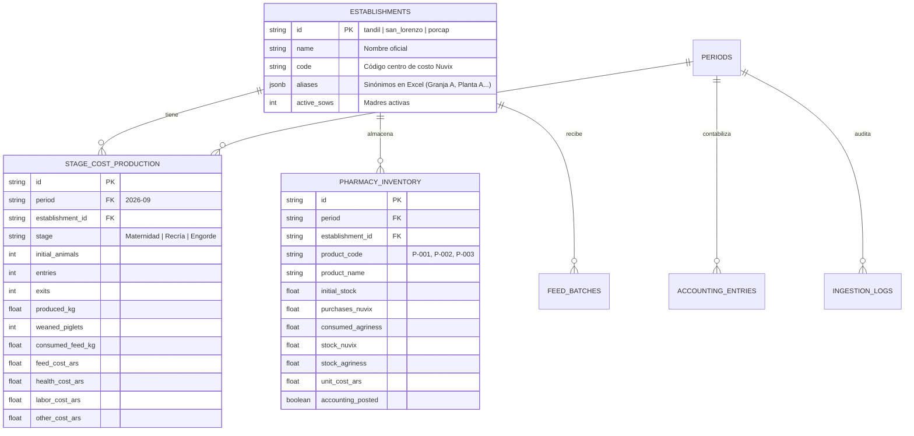

# 🏛️ Arquitectura de Dominio y Preparación para Persistencia (SIPA Project)

## 1. Análisis del Dominio Porcino (Uniporc Tandil)

El negocio de producción porcina intensiva de **Uniporc** integra tres eslabones operativos que manejan unidades de medida, tiempos de registración y vocabularios distintos:

1. **Producción Biológica en Granjas (`Agriness` & `S4Farm`):**
   * **Establecimientos:** `Tandil (Granja A)`, `San Lorenzo (Granja B)`, `Porcap (Granja C)`.
   * **Flujo continuo por etapas (Sitios):**
     * **Sitio 1 — Maternidad:** Gestación, partos, lechones nacidos vivos y lechones destetados (KPI principal: **Costo por lechón destetado**).
     * **Sitio 2 — Recría:** Ingreso de lechones destetados (~6,3 kg) y consumo de ración *Iniciador*.
     * **Sitio 3 — Engorde / Terminación:** Desarrollo hasta peso de faena con raciones *Crecimiento* y *Terminador* (KPIs principales: **Costo por kg producido** y **Conversión alimenticia aparente FCR**).
2. **Industrialización de Alimento Balanceado (`SCADA`):**
   * El alimento representa entre el **75% y el 80%** del costo total del cerdo.
   * Las plantas elaboradoras dosifican maíz, harina de soja y núcleos vitamínicos mediante celdas de carga en tolvas.
   * Requiere control de cuadratura física por lote (`Control kg = 0`) y conciliación de mermas en silos por humedad o pesaje.
3. **Administración, Finanzas y Contabilidad (`Nuvix ERP`):**
   * Registra las facturas de compra de materias primas, medicamentos veterinarios, fletes pactados en USD/ARS y sueldos.
   * Imputa gastos por **Centro de Costo** y requiere asientos contables de partida doble al cierre de cada mes.

---

## 2. Por qué SIPA está diseñado para incorporar Base de Datos en la Iteración 2

Tal como relevó el equipo con **Sofía Gonzalez Grenat**:
> *"Actualmente realizamos el análisis y la consolidación de costos una vez por mes. La idea sería mantener el cierre mensual, pero poder incorporar información y realizar controles durante el mes, sin esperar al cierre para detectar diferencias o errores."*

### Esquema Relacional Proyectado (Iteración 2 — PostgreSQL / Prisma)

El archivo [`src/types/domain.ts`](../src/types/domain.ts) define exactamente las entidades que se mapearán 1:1 a tablas SQL en la siguiente iteración:

---

## 3. Separación de Responsabilidades en el Código

* **`src/types/domain.ts`:** Contratos de datos e interfaces de dominio.
* **`src/services/sipaEngine.ts`:** Motor matemático puro (las 9 fórmulas zootécnico-contables y el motor de mapeo heurístico de encabezados Excel). No tiene dependencia de React, por lo que puede compartirse o moverse directamente a un backend Node.js / TypeScript.
* **`src/data/initialUniporcData.ts`:** Semilla de datos (Seed) fiel a los 9 archivos del desafío + establecimientos reales de Uniporc.
* **`src/components/views/*`:** Vistas modulares por sector operativo.
